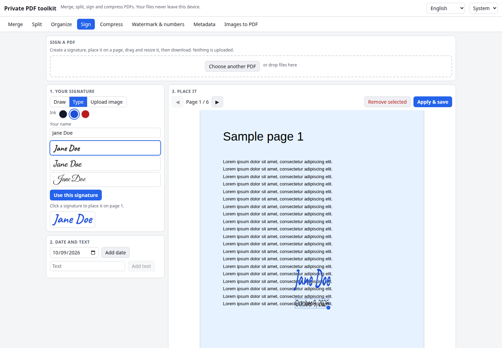

# Private PDF Toolkit

Merge, split, organize, sign, compress and stamp PDFs without uploading them anywhere. Every tool runs in your browser with [pdf-lib](https://pdf-lib.js.org/) for editing and [pdf.js](https://mozilla.github.io/pdf.js/) for thumbnails and rendering. Your files never leave your computer, and once loaded the site works offline.

**Try it: [hermes98761234.github.io/private-pdf-toolkit](https://hermes98761234.github.io/private-pdf-toolkit/)**

[](https://github.com/hermes98761234/private-pdf-toolkit/actions/workflows/deploy.yml)



## Features

- **Merge.** Add several PDFs, drag the files into order, or switch to the page view and drag, rotate, delete or insert pages across all files, with thumbnails.
- **Split.** By ranges (`1-3, 5, 8-`), every N pages, or by clicking the pages to extract. Several outputs download as a ZIP.
- **Organize.** Rotate, delete and reorder pages, and insert blank pages.
- **Sign.** Draw a signature on a canvas, type it in a handwriting-style font, or upload an image (white can be made transparent). Place it on any page, drag and resize it, and add a date or free text.
- **Compress.** Re-render pages to JPEG at the DPI and quality you choose, with the size shown before and after. A lossless option repacks the file into object streams and can strip metadata.
- **Watermark and page numbers.** A diagonal text watermark with size, angle, opacity and colour, and page numbers in several formats and positions.
- **Metadata editor.** See and edit title, author, subject, keywords, creator and producer, or remove all metadata, including the XMP packet.
- **Images to PDF.** Reorder photos and scans and put them on A4, Letter, or pages the size of the image.
- **English and Ukrainian, light, dark or system theme.** Settings are kept in the browser.
- **Private and offline.** No backend, no tracking. A small service worker caches the app after the first visit.

## How it works

Editing uses pdf-lib on the raw bytes: pages are copied into a new document (merge, split, organize), images are embedded and drawn at positions mapped from the displayed page to the page's own coordinates, so rotated pages work too. Metadata removal deletes the Info dictionary and the XMP stream from the file, not just their values.

pdf.js draws the thumbnails and the page you sign, and re-renders pages to JPEG for lossy compression. Its worker is bundled with the site (imported with `?url`), so nothing is fetched from a CDN. Handwriting fonts come from `@fontsource` packages and are bundled as well.

Limitations: password-protected PDFs cannot be opened. Lossy compression turns text into pictures, so it is no longer selectable. Watermark and page numbers use a built-in Latin font; to put other scripts on a page, use the Sign tool's text stamp, which draws text as an image.

## Quick start

You need [Node.js](https://nodejs.org/) 22.

```bash
git clone https://github.com/hermes98761234/private-pdf-toolkit.git
cd private-pdf-toolkit
npm install
npm run dev       # http://localhost:5173
npm test          # page ranges, merge/split, metadata stripping, zip, i18n
npm run build     # static site in dist/
```

## License

MIT
